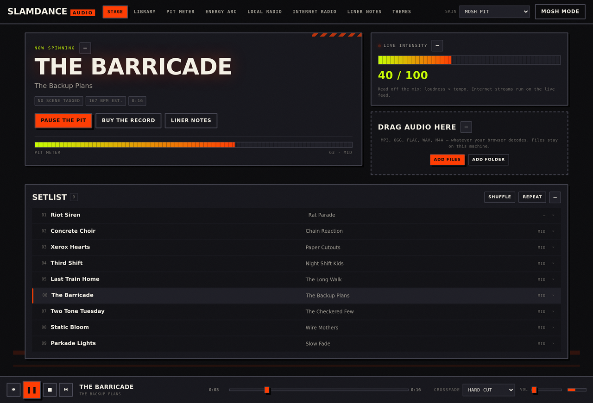
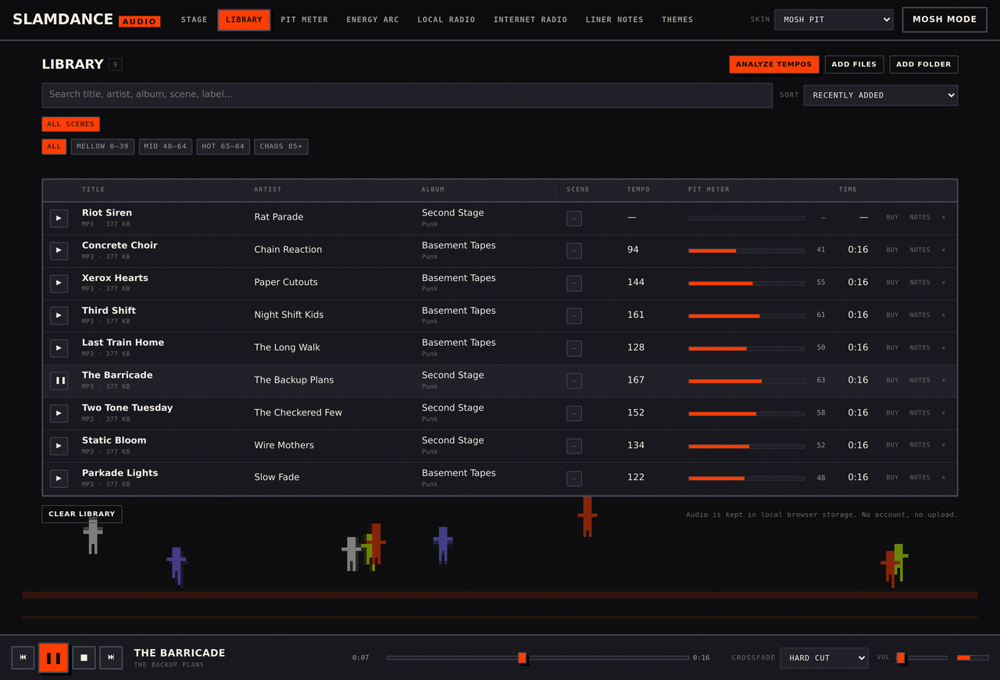
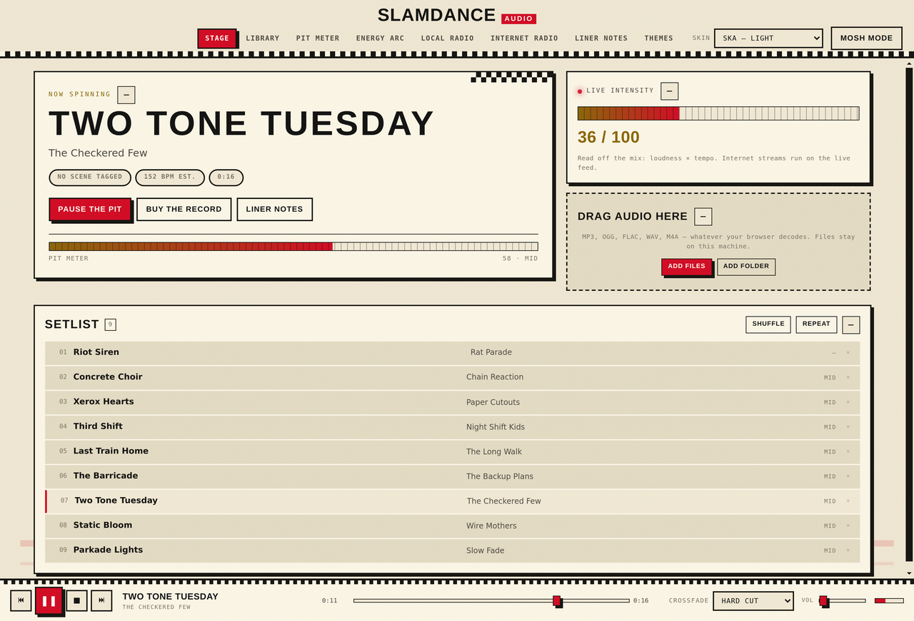
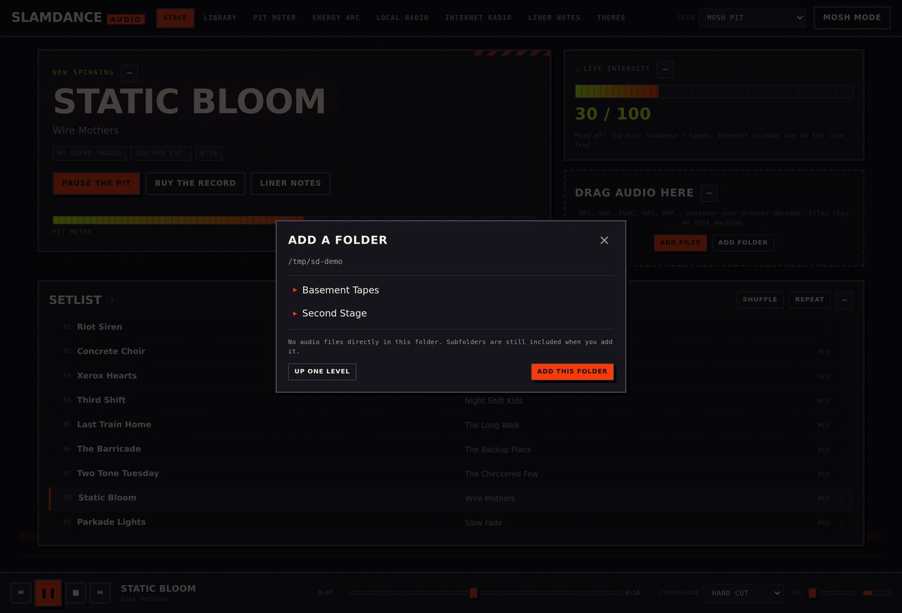

# Slamdance Audio

~[Slamdance Audio Icon/Logo](slamdanceaudio-icon.png)
An offline-first music player for people who care about the music. Your files stay on your
machine — no account, no upload, no telemetry, no network request unless you tune an internet
stream yourself.

The same static player runs three ways: as a Tauri app on Linux, macOS and Windows, as an
Electron app on FreeBSD, and straight from `index.html` behind any static file server. There is
no bundler, no framework and no build step for the web files.



## What it does

- **Local library from your own files** — MP3, OGG, OGA, FLAC, WAV, M4A, AAC, Opus, WebM. Tags are
  read in the page, audio blobs live in IndexedDB, and nothing is copied anywhere else.
- **Add files or a whole folder.** The desktop builds browse folders in-app: you see where you
  are, you pick a subfolder to descend into, and *Add this folder* imports **that** folder and
  everything under it. Files are read a few at a time, so a huge folder doesn't fill memory.
  Importing the same song twice merges into one row instead of duplicating it.
- **Pit Meter** — every track scores 0–100 from tempo and loudness, with heat filters, sorting and
  a per-track readout.
- **Energy Arc** — builds a set that warms up, peaks around two thirds and closes with a banger.
- **Local Radio** — your library as a station, with DJ talk breaks and a station ID.
- **Internet Radio** — paste a direct stream URL and it plays through the same transport.
- **Liner Notes** — scene, label, era, BPM, notes and a Bandcamp/buy link per track.
- **Mosh Mode** — a pixel-crowd visualizer with its own HUD.
- **Themes** — five house skins, each one CSS file in its own folder, plus a Theme Workshop for
  new colour/type recipes and `.sdt` or folder import for skins made by other people.
  See [THEMES.md](THEMES.md).
- **The usual player things** — queue, shuffle, repeat, seek, volume, crossfade, drag and drop,
  search, sort, re-link a moved file, and keyboard shortcuts.

| Library | A second skin |
| --- | --- |
|  |  |



*Screenshots use generated demo tracks.*

## Requirements

| You want to… | You need |
| --- | --- |
| just use a packaged app | nothing — install the `.deb`, AppImage, `.dmg` or installer |
| build on Linux | Node.js 20+, Rust (rustup), and the WebKitGTK 4.1 / GTK 3 / libsoup 3 development packages that `pkg-config` can find as `webkit2gtk-4.1`, `javascriptcoregtk-4.1`, `gtk+-3.0` and `libsoup-3.0` |
| build on macOS | Node.js 20+, Rust, and Xcode Command Line Tools (`xcode-select --install`) |
| build on Windows | Node.js 20+, Rust with the MSVC toolchain, Visual Studio Build Tools, and WebView2 (present on Windows 10/11) |
| build on FreeBSD | Node.js 20+ and pkg(8); runs against the Electron runtime (`pkg install devel/electron44`) |

Tauri is native software: each Linux/macOS/Windows package must be built on that operating
system (or a CI runner for it). The FreeBSD archive can be assembled anywhere, but it links
against the Electron already installed on FreeBSD rather than carrying its own copy.

## Build

```sh
./build.sh              # this machine's installer(s)
./build.sh linux        # Tauri: .deb + AppImage
./build.sh macos        # Tauri: .dmg (+ .app)
./build.sh windows      # Tauri: NSIS installer
./build.sh freebsd      # Electron: runtime-linked FreeBSD .tar.gz + .pkg
./build.sh stage        # only refresh build/web
./build.sh --help       # every option
```

`build.sh` is a thin wrapper around `scripts/build.mjs`: it checks the Node version, installs the
Tauri CLI on the first build (`npm install`) and passes every argument through. A release build
takes a few minutes; `--no-bundle` stops after compiling the binary.

| Command | Result |
| --- | --- |
| `./build.sh linux` | `dist/slamdance-audio-linux-<arch>/deb/*.deb` and `…/appimage/*.AppImage` |
| `./build.sh macos` | `dist/slamdance-audio-macos-<arch>/dmg/*.dmg` |
| `./build.sh windows` | `dist/slamdance-audio-windows-<arch>/nsis/*-setup.exe` |
| `./build.sh freebsd` | `dist/slamdance-audio-freebsd-<arch>.tar.gz` plus, on FreeBSD, `dist/slamdance-audio-freebsd-<arch>.pkg` (`doas pkg install` it) |
| `./build.sh stage` | `build/web/` — the static player, ready to copy anywhere |

Options:

| Option | Effect |
| --- | --- |
| `--debug` | Tauri debug build instead of release |
| `--no-bundle` | compile the binary, skip the installer |
| `--no-install` | fail instead of running `npm install` |
| `--bundles deb,appimage` | choose Tauri bundle types |
| `--triple aarch64-apple-darwin` | build for a specific Rust target |

`node scripts/build.mjs …` does the same thing without the wrapper; `npm run build`,
`npm run build:linux`, `npm run build:macos`, `npm run build:windows`, `npm run build:freebsd`
and `npm run stage` are the shortcuts.

## Run during development

The web player is static, but service it over HTTP — browsers can refuse IndexedDB on `file://`
origins, and IndexedDB is where the library lives:

```sh
python3 -m http.server 8000     # then open http://localhost:8000
```

For the desktop shells:

```sh
npm install
./build.sh stage                # the shell loads build/web
npx tauri dev                   # Tauri window running the staged player
```

On FreeBSD, run the Electron shell with the runtime already installed:

```sh
electron .                      # or: ELECTRON_BIN=/path/to/electron ./bin/slamdance-audio
```

## Keyboard

| Key | Action |
| --- | --- |
| `Space` | Play / pause |
| `←` `→` | Seek back / forward |
| `N` / `P` | Next / previous track |
| `S` | Stop |
| `M` | Mosh Mode |
| `Esc` | Leave Mosh Mode, or close the folder browser |

## Where your data lives

Settings (skin, layout, saved streams, liner notes, imported themes) go in `localStorage` under
`slamdance.v1`. Audio blobs go in IndexedDB, keyed by size, modification time and name. Clearing
site data removes both — the player then marks those rows as needing a re-link, and pointing it
at the files again restores them. Nothing is written outside the app's own storage.

## Project layout

```
index.html            the player — loaded by every shell
styles.css            base layout and components (themes override it)
js/                   player, storage, analysis, bpm, arc, mosh, themes, theme import
themes/               manifest.js plus one folder per skin
src-tauri/            Rust shell for Linux, macOS and Windows (folder browse/scan/read commands)
electron/             main + preload for the FreeBSD shell
scripts/              build.mjs and stage-web.mjs
tests/                selftest.js
docs/screenshots/     the images above
build.sh              the build entry point
```

## Tests

```sh
npm test            # node tests/selftest.js
```

The self-test covers the pure logic — BPM scoring, the arc builder, theme CSS generation — without
a browser.

## Export locations, signing and other build notes

- Installers come out in `dist/`, staged web files in `build/web/`; both are disposable.
- The AppImage build patches `pkg-config` copies on `/usr/lib64` distros (Void, Fedora, openSUSE)
  so linuxdeploy finds GTK's `immodules.cache`; no manual setup is needed.
- Linux playback needs GStreamer. The AppImage bundles the media framework (base, good, bad and
  ugly plugins), and the .deb depends on those packages plus `gstreamer1.0-libav`, so MP3, FLAC
  and friends decode without extra setup. Building the AppImage's media bundle needs `patchelf`
  on the build machine.
- An AppImage carries the build machine's WebKitGTK. One built on Void runs on Void, but inside an
  Ubuntu distrobox/podman container its web process may never start (the window stays blank) — use
  the .deb there, or build the AppImage on the distro you plan to run it on.
- macOS signing and notarization are not configured — add your identity to the Tauri config for
  distribution beyond your own machine.
- The FreeBSD .pkg declares Electron as a dependency and installs to `/usr/local`; the .tar.gz expects Electron on the machine that runs it (`ELECTRON_BIN` overrides the
  executable the launcher uses.

## License

MIT — see [LICENSE](LICENSE). © 2026 Will Michaels / Fearless Geek Media.
